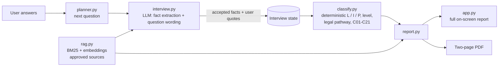

# TrustAI Risk Assessment Agent

> **Research prototype.** The output is a **preliminary, declaration-based assessment**. It is not a technical verification, a control test, a compliance finding, a certificate or legal advice. No license has been granted yet (see [docs/HANDOVER.md](docs/HANDOVER.md)).

## 1. Project Overview

A Streamlit application that interviews a person who knows an AI agent and produces a preliminary risk assessment of that agent **from their statements only**. It never contacts the assessed agent, runs tests, or asks for logs, code or evidence.

Each assessment yields:

| Output | Values | Meaning |
|---|---|---|
| Autonomy **L** | L0–L5 | What the agent can do without a person: L0 information only, L1 recommends, L2 drafts, L3 acts after approval bound to that action, L4 acts within an envelope without per-action approval, L5 can expand its own authority |
| Impact **I** | I0–I3 | Declared reasonable worst-case harm (minimal, limited, serious, critical) |
| Posture **P** | P1–P4 | Assurance posture from the policy table (impact × autonomy), raised by at most one step for declared exposure factors. P4 = "hold for redesign", an internal release posture, **not** a legal prohibition |
| Risk level | LOW / MEDIUM / HIGH / FORBIDDEN | TrustAI label derived from P (P1 LOW, P2 MEDIUM, P3 and P4 HIGH). FORBIDDEN is issued only for a supported EU AI Act Art. 5 finding. These are **TrustAI labels, not EU AI Act categories** |
| Legal pathway | separate field | Art. 6 high-risk screening (Annex III, Annex I). A supported high-risk pathway makes the level at least HIGH without changing P |
| Controls | C01–C21 | Per-control status from the declarations: Declared present, Declared absent, Partially assessed, Unknown, Not assessed, Not applicable |

L, I, P and C01–C21 come from an **internal TrustAI assessment policy** (`catalogs/policy.json`, `catalogs/controls.json`). It is not an external standard and has not been externally validated.

## 2. Key Features

- Question-based interview, target 12 and hard limit 20 questions, with checklist questions and free-text answers.
- A fact is accepted only with a quote that matches the user's own words (stem-level match, so it proves origin, not meaning); instruction-like text inside answers is ignored.
- Deterministic classification: no model call and no retrieval in `classify.py`; every step is traced with a rule ID.
- Local RAG (BM25 plus embeddings) over approved sources, with a support check before a passage is shown.
- Explicit handling of uncertainty: "unknown" is never silently a "no".
- On-screen review of the collected facts before the result, and a two-page client PDF.

## 3. System Architecture



Three roles are kept apart: **the LLM extracts facts and words questions; RAG retrieves evidence and citations; classification is deterministic code** that sees neither the model nor the index. Retrieved text and model output cannot change the result. Details: [docs/ARCHITECTURE.md](docs/ARCHITECTURE.md).

## 4. Quick Start

Requires an OpenAI API key and Python 3.12 or 3.14 (both verified on macOS; 3.13 and Linux are untested).

```bash
git clone https://github.com/aslinnaz/risk-assessment-agent.git
cd risk-assessment-agent
python3 -m venv .venv && source .venv/bin/activate
pip install -r requirements.txt          # or requirements-tested.txt for the exact tested versions
cp .env.example .env                     # then set OPENAI_API_KEY in .env (never committed)
streamlit run app.py                     # http://localhost:8501
```

The five source PDFs listed in [docs/SOURCES.md](docs/SOURCES.md) must be present in `sources/` with their exact names; the application checks this at startup and stops with a message naming any missing file. The first start embeds the source passages through the OpenAI API (a one-off cost, cached in `.cache/`). Models default to `gpt-4.1-mini` and `text-embedding-3-small` (`OPENAI_MODEL`, `OPENAI_EMBED_MODEL`).

## 5. Assessment Workflow

1. **Interview.** The user describes the agent; the planner picks the next question (conflicts, one follow-up after "I don't know", missing critical facts, a few context topics).
2. **Extraction.** The model turns each answer into structured facts; code validates each against the user's own words.
3. **Screening.** Prohibited-use screening (Art. 5) is one combined checklist. An unticked item is not a "no" unless the user ticks "This is the complete list" or chooses "None of these".
4. **Review.** The user sees every fact as confirmed, explicit negative, unknown or not collected, and can edit earlier answers.
5. **Classification.** L, I, P, risk level, legal pathway and C01–C21 are computed from the accepted facts only.
6. **Report.** Evidence is retrieved for each finding and checked; the result is shown with its derivation.

EU AI Act screening (Art. 5, Art. 6, Art. 50) is a reference check against the loaded legislative text. It identifies pathways that need legal review. It does not establish legal applicability, compliance or non-compliance. Rules: [docs/METHODOLOGY.md](docs/METHODOLOGY.md).

## 6. Outputs

- **In the application:** the full report with the answer-to-result trace, retrieved evidence with citations, the three separate statuses (interview, assessment, verification: always "Not technically verified"), and the C01–C21 coverage table.
- **PDF (two pages, three at most):** page 1 = assessed agent, result (level, L, I, P), why, up to three next steps, limitation; page 2 = the C01–C21 table (ID, control, assessment, finding). The PDF contains **no** sources, retrieval diagnostics, answer trail or derivation trace; those exist only in the application session.
- Nothing is stored by the application beyond the Streamlit session and the local `.cache/` (source passages and embeddings).

## 7. Testing

```bash
python -m pytest -q                       # offline, scripted model, no API calls or key needed
python tools/verify_catalog.py            # catalog citations and interview anchors against the real source passages
python -m pytest -m live -s -q            # real OpenAI calls; costs money; run deliberately
```

Offline tests that need the source PDFs skip when `sources/` is empty, so a skip count is not a pass. GitHub Actions runs the offline suite on every push and pull request ([.github/workflows/ci.yml](.github/workflows/ci.yml)). Verified results, known gaps and reproduction steps: [docs/VALIDATION.md](docs/VALIDATION.md).

## 8. Documentation

| Document | Contents |
|---|---|
| [docs/ARCHITECTURE.md](docs/ARCHITECTURE.md) | Modules, data flow, dependencies, design decisions |
| [docs/METHODOLOGY.md](docs/METHODOLOGY.md) | Classification rules, rule provenance, uncertainty handling, C01–C21 |
| [docs/VALIDATION.md](docs/VALIDATION.md) | Test categories, verified results, historical records, gaps |
| [docs/DEVELOPER_GUIDE.md](docs/DEVELOPER_GUIDE.md) | Setup, configuration, troubleshooting, adding sources, extending |
| [docs/HANDOVER.md](docs/HANDOVER.md) | Status, known issues, operating requirements, next steps |
| [docs/SOURCES.md](docs/SOURCES.md) | Source manifest, provenance, redistribution status |
| [evals/RESULTS.md](evals/RESULTS.md) | Historical live-evaluation log (dated records) |

## 9. Limitations & Disclaimer

- **Declarations only.** A quote shows that the words came from the user, not that they are true or mean the extracted fact. No safeguard is verified.
- **Internal policy.** L, I, P, the P-to-level mapping, the escalation factors and C01–C21 are project choices that have not been externally validated.
- **FORBIDDEN and legal pathways** depend on model-extracted facts and are preliminary findings that require human legal review.
- **Legislation currency is not verified.** The loaded AI Act is the original 2024 text; obligation dates in `catalogs/policy.json` have not been checked against an official source.
- **Model variance.** Live extraction is not deterministic; the live evaluation is small and is not a statistical validation.
- **Not production software.** No authentication, persistence, multi-user support or data-protection review. User answers and source passages are sent to the OpenAI API.
- **Source documents.** Redistribution rights for some bundled PDFs are not established; see [docs/SOURCES.md](docs/SOURCES.md) before sharing the repository.
