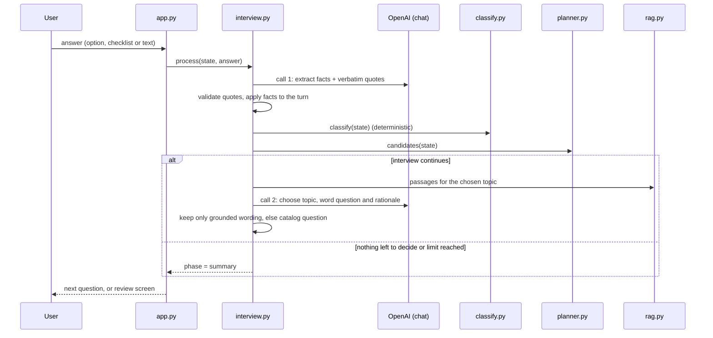

# Architecture

The application is a flat Python project (no package layout): one Streamlit entry point, six core modules, JSON catalogs that hold all policy and interview content, and a test suite. This document describes what the code does today. Recommendations for change are marked **Not implemented**.

## Modules

| File | Responsibility | Calls a model? | Uses the retrieval index? |
|---|---|---|---|
| `app.py` | Streamlit UI: start screen, interview, history, review screen, result, sidebar (setup status) | No (delegates) | Prepares it at startup |
| `interview.py` | Per-turn processing: answer → extraction call → state update → question call; prompts (`SYSTEM_EXTRACT`, `SYSTEM_QUESTION`); quote validation; checklist semantics; review-screen sections | Yes | Yes (rationale passages) |
| `planner.py` | Chooses candidate topics: conflicts, one follow-up after "unknown", blocking critical facts, answer impact, context topics; decides when the interview ends | No | No |
| `classify.py` | `derive` (turns → accepted facts), `classify` (L, I, P, level, legal pathway, forbidden findings, blockers, C01–C21, gaps), `trace_integrity` | **No** | **No** |
| `rag.py` | PDF/Word extraction, structure-aware chunking, BM25 plus embedding index, support check, startup validation | Embeddings only | Is the index |
| `report.py` | `build_report` (findings with citations, trace), `client_summary`, `pdf_bytes` (two-page PDF) | Yes (one batched support check) | Yes |
| `llm.py` | OpenAI wrapper: structured output, one retry on transient errors, errors that do not leak the key, token usage | Is the wrapper | No |
| `config.py` | Environment settings, paths, question limits (target 12, max 20, context topics 3) | No | No |
| `sources_admin.py`, `tools/add_source.py` | Register, validate, deactivate approved sources added after deployment | No | No |
| `tools/verify_catalog.py` | Checks that curated catalog citations exist and are supported by the real passages | No | Yes |
| `catalogs/*.json` | `policy.json` (L/I/P tables, labels, blockers, improvements), `controls.json` (C01–C21, `assessment_rules`, scope rules), `interview.json` (46 topics, slots, equivalences), `sources.json` (manifest) | n/a | n/a |
| `evals/` | Golden scenarios (`scenarios.py`) and the dated live-evaluation log (`RESULTS.md`) | n/a | n/a |

`classify.py` imports neither `llm` nor `rag`; this is the central design guarantee and is covered by tests (`tests/test_decision.py`).

## Data flow

**Phases** (`state["phase"]`): `interview` → `summary` (review screen; the user confirms or corrects) → report; `forbidden` is entered as soon as a supported Art. 5 finding exists and ends the interview.

**Interview state** is a list of turns. Each turn holds the question (kind, topic, options, checklist definition), the answer and `updates` (accepted slots, per-workflow authority facts, control declarations, evidence quotes, rejected extractions with reasons). Nothing else is authoritative: `classify.derive` folds the turns in order into the single set of accepted facts that every consumer reads (classification, planner, review screen, report). `classify.trace_integrity` fails a report if a decision input is not an accepted fact. The state lives in the Streamlit session only.

**Per-workflow authority.** The agent's authority is stored as one fact set per workflow (action plus condition), for example "creates purchase orders up to a threshold, without approval". The scalar facts (`action_mode`, `approval_exists`, `approval_bound`, `limits_enforced`) are derived from the maximum authority over workflows. A contradiction exists only when the same workflow and field are described two different ways.

**Model calls per answered question:** one extraction call, one question call (skipped for code-written conflict and follow-up questions), and one query embedding. A report adds one batched claim–passage support check and claim embeddings. In one observed live interview (14 answers) the counted interview calls were 14 extraction, 12 question and 12 embedding queries, about 91k prompt and 3k completion tokens, excluding report calls (n = 1; not a cost guarantee).

## Retrieval and evidence

1. **Extraction and chunking** (`rag.py`): PyMuPDF is the primary extractor and pypdf the fallback; both are normalised so each yields the same structure. The AI Act is chunked by article, paragraph, annex and recital; the playbooks and NIST by section. Chunks are cached in `.cache/` by file hash.
2. **Startup validation:** `check_sources` requires every manifest source marked `rag` and `api_transfer_allowed`; `Index.validate` requires AI Act Art. 1–113, Annexes I–XIII, recital 180 and every anchor cited by the catalogs, and raises `SourceError` otherwise.
3. **Routing:** each topic or finding is routed by concern (legal, agentic, oversight, transparency, data) to the relevant sources.
4. **Candidates:** curated anchors first, then BM25 plus embedding search.
5. **Support check:** a passage is shown only if its keywords and embedding similarity support the claim. At report time one batched model call checks meaning; unsupported passages are dropped and listed, partial support is flagged and never promoted.
6. **Embeddings:** persisted in `.cache/emb_<model>.npz`, aligned by passage id and text digest; only missing passages are embedded. If embedding fails, search falls back to keywords and the sidebar and report say so.

The internal policy is **not** a retrievable source: it is never indexed, retrieved or cited. Source text is treated as data; instructions inside it are never applied.

## Report and PDF

`report.build_report` produces the full in-application report: the three statuses (interview, assessment, verification), the derivation trace for L, I, P, legal pathway and level, findings with citations, and the C01–C21 table. `client_summary` + `pdf_bytes` render a **separate two-page client summary** (page 1: agent, result, why, up to three next steps, limitation; page 2: C01–C21 table). The PDF omits sources, diagnostics, answer trail and trace by design. It embeds the Bitstream Vera font that ships with ReportLab, checks required glyphs at start, and raises an error instead of silently falling back (`REPORT_FONT`, `REPORT_FONT_BOLD` override).

## Dependencies

| Package | Use | Licence (from installed metadata) |
|---|---|---|
| streamlit | UI | Apache-2.0 |
| openai | Chat and embeddings client | Apache-2.0 |
| pymupdf | PDF text extraction (primary) | **AGPL-3.0 or Artifex commercial licence** |
| pypdf | PDF fallback extractor | BSD-3-Clause |
| numpy | Embedding arrays, similarity | BSD-3-Clause (plus bundled notices) |
| reportlab | PDF generation | BSD |
| python-dotenv | `.env` loading | BSD-3-Clause |
| pytest | Tests | MIT |

The AGPL licence of PyMuPDF affects how a combined work may be distributed or offered as a network service; see [HANDOVER.md](HANDOVER.md). External service: the OpenAI API (default models `gpt-4.1-mini`, `text-embedding-3-small`). No other network access exists in the code.

## Design decisions

- **Deterministic result.** The risk result must be reproducible and explainable, so the model never computes or adjusts it.
- **Quotes as the acceptance rule.** A model-extracted fact needs a quote that matches the user's words (stem-level match); a negative needs an explicit negation and a quote about that fact. This limits fabrication but proves neither truth nor that the quote supports the value (live runs showed the model occasionally attaching an unrelated quote; see VALIDATION.md).
- **One state, folded from turns.** Corrections and edits re-derive the state; there is no second copy that can drift.
- **Checklist semantics.** Ticked means yes; unticked means unknown (asked once more, open items only) unless "complete list" is ticked or "None of these" is chosen. A checklist is the only answer interface of its question.
- **Catalog-written questions.** Question wording comes from the catalog; a model-written opening sentence is kept only if its content words occur in the conversation.
- **Policy in JSON.** Thresholds, tables and texts are data in `catalogs/`, not code, and are frozen by tests.
- **Concise PDF.** Evidence and traces stay in the application; the client document stays short.
- **Flat layout kept.** Modules were not moved into a package to avoid churn in a handover.

**Not implemented:** persistence of assessments, authentication, multi-user use, evidence upload or verification, automatic legislation-currency checks, alternative LLM providers, a package layout.
